# Application Flow Document

## Gaming Brand & Community Platform

**Document:** 02_App_Flow.md  
**Version:** 1.0  
**Status:** Draft — Pending Review  
**Related Document:** 01_PRD.md

---

# 1. Overview

This document defines the navigation structure and application workflows for the Gaming Brand & Community Platform.

It describes how each type of user interacts with the platform, which pages they can access, and how information moves through the application.

The platform has three user types:

1. Public Visitor
2. Moderator
3. Admin

Public visitors do not need authentication. Only moderators and administrators can access the management panel.

---

# 2. Application Structure

## 2.1 Public Website

```text
Public Website
│
├── Home
│   ├── Hero / Brand Introduction
│   ├── Featured Content
│   ├── Featured Moderators
│   ├── Scam Awareness Notice
│   └── Social Media Links
│
├── IDs / Content
│   ├── All Public Content
│   └── Content Details
│
├── Moderators
│   ├── Moderator Directory
│   └── Moderator Details
│       ├── Profile Information
│       ├── Online / Offline Status
│       ├── Available / Busy Status
│       └── Moderator's Public Content
│
├── About
├── Contact
└── Language Switcher
    ├── Bangla
    └── English
```

**Note:** The IDs section represents the proposed account marketplace. Account-trading listings and related transaction/contact flows remain disabled pending compliance approval. The public directory can display other permitted gaming-related content.

## 2.2 Management Panel

```text
Management Panel
│
├── Login
│
├── Dashboard
│
├── Content Management
│   ├── My Content (Moderator)
│   ├── All Content (Admin)
│   ├── Create Content
│   ├── Edit Content
│   └── Content Details
│
├── Moderator Management (Admin)
│   ├── All Moderators
│   ├── Create Moderator
│   ├── Edit Moderator
│   └── Account Status
│
├── Profile Management
│
├── Activity Logs
│
├── Scam Alerts / Announcements
│
├── Website Settings (Admin)
│
└── Logout
```

---

# 3. Public Visitor Flow

Visitors can access all public pages without creating an account.

## 3.1 Homepage Flow

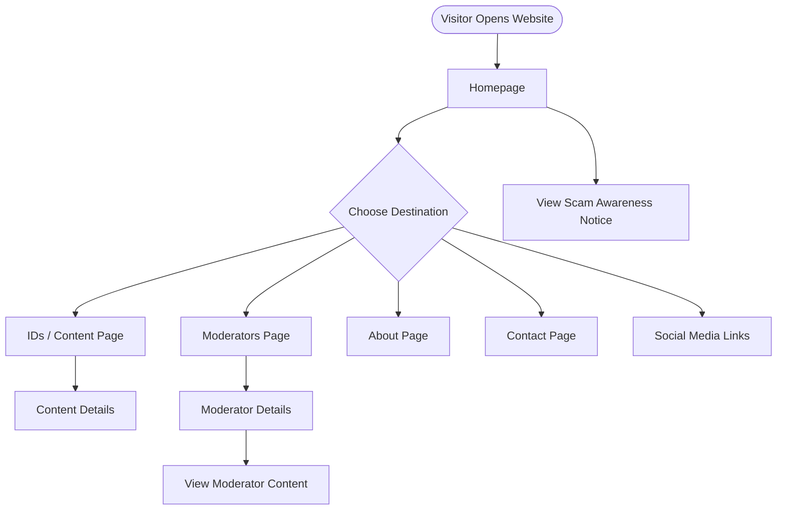

### Homepage behavior

- Visitors can navigate to any public section.
- Featured content links open the corresponding details page.
- Featured moderator cards open moderator details.
- Scam-awareness notices are visible according to admin settings.
- The language switcher changes the public website language.

## 3.2 Public IDs / Content Flow

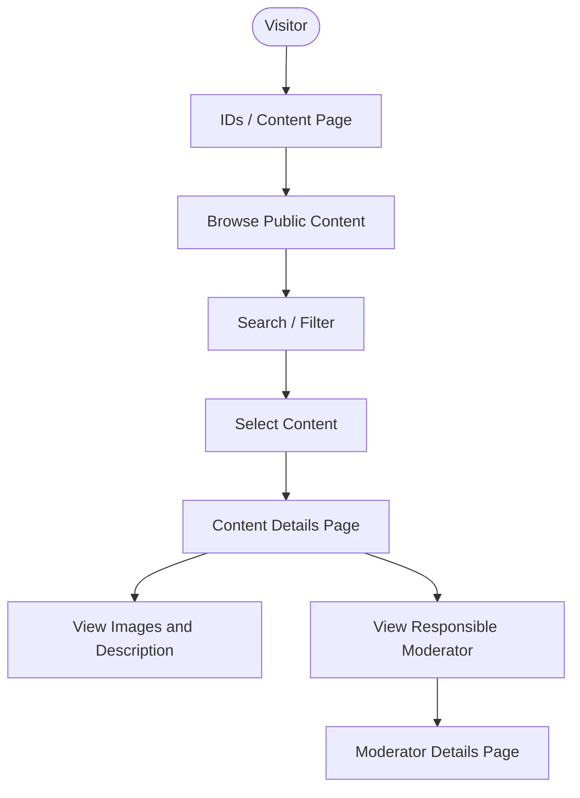

### Content visibility rules

- Only published content approved for public display can appear.
- Archived, unpublished, and deleted content must not appear publicly.
- Each content item must have a responsible moderator.
- Content details must display the correct moderator association.
- Account-sale listings and transaction-related actions remain disabled pending compliance approval.

## 3.3 Moderator Directory Flow

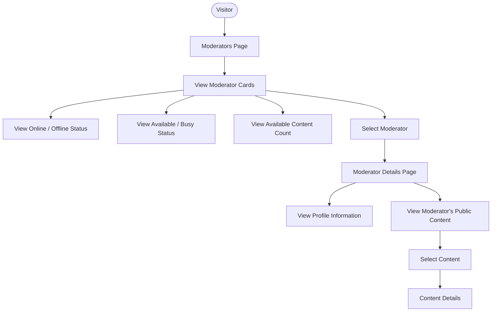

### Moderator card information

Each card must contain:

- Profile image.
- Gaming name.
- Online / Offline indicator.
- Available / Busy indicator.
- Available published content count.
- View Profile action.

The content count must be calculated dynamically and must reflect only eligible, publicly visible content marked as available.

## 3.4 Moderator Details Flow

The moderator details page has a fixed information hierarchy.

```text
Moderator Details Page
│
├── Moderator Profile Header
│   ├── Profile Image
│   ├── Gaming Name
│   ├── Online / Offline
│   ├── Available / Busy
│   ├── Short Biography
│   └── Permitted Contact Action
│
└── Moderator's Public Content
    ├── Content Card 1
    ├── Content Card 2
    ├── Content Card 3
    └── View Content Details
```

The profile information must appear above the content listing.

Only content associated with the selected moderator should appear in this section.

---

# 4. Moderator Authentication Flow

Moderators cannot register publicly.

Their accounts are created and managed by Admin.

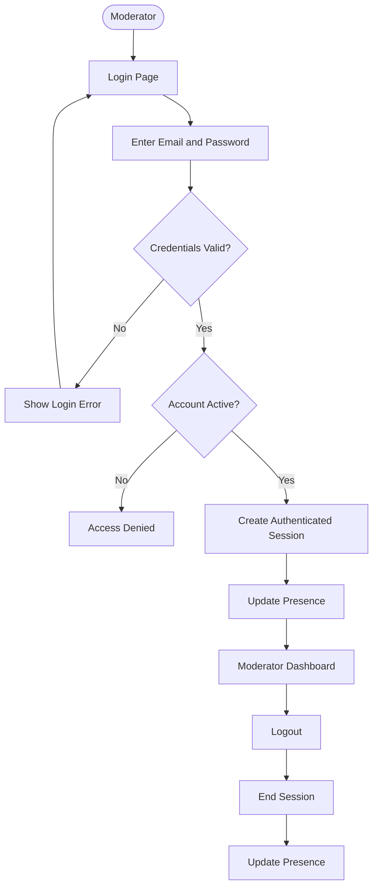

### Authentication rules

- Login requires valid credentials.
- Suspended or deactivated accounts cannot log in.
- Passwords must be securely hashed.
- Successful authentication redirects the moderator to their dashboard.
- Logout must invalidate the authenticated session.
- Login attempts should be rate-limited.
- Password reset must follow a secure process.

---

# 5. Moderator Dashboard Flow

## 5.1 Dashboard Overview

After login, the moderator sees their personal dashboard.

```text
Moderator Dashboard
│
├── Overview
│   ├── Total Content
│   ├── Published Content
│   ├── Available Content
│   └── Archived Content
│
├── My Content
│   ├── Content List
│   ├── Create Content
│   ├── Edit Content
│   └── Archive Content
│
├── Availability Settings
│   ├── Available
│   └── Busy
│
├── My Profile
│
├── Activity History
│
└── Logout
```

## 5.2 Content Creation Flow

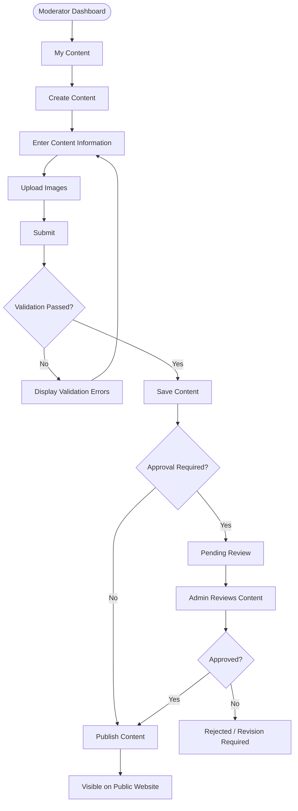

### Creation rules

- The authenticated moderator is automatically assigned as the content owner.
- Moderators cannot assign their content to another moderator.
- All submitted fields must be validated.
- Images must pass file type and file size validation.
- The system records creation time and the responsible moderator.
- If admin approval is enabled, submitted content remains private until approved.

## 5.3 Content Update Flow

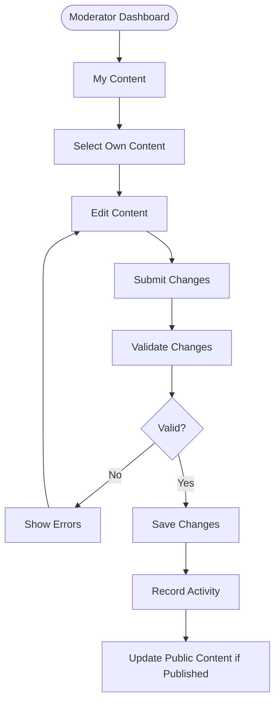

A moderator must never be able to update another moderator's content by changing a URL or submitting a manipulated request.

## 5.4 Availability Status Flow

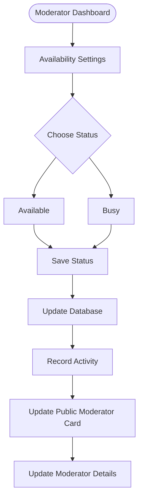

Availability is manually controlled by the moderator.

Online/offline status is controlled separately by the presence system.

---

# 6. Admin Authentication Flow

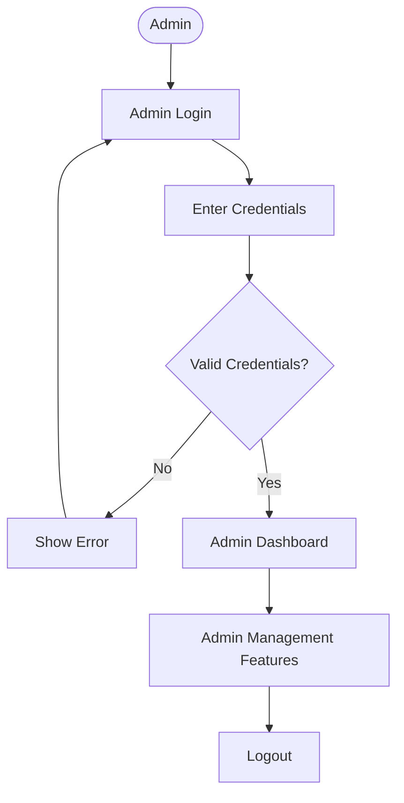

Admin access must be protected by server-side role authorization.

The system must not rely on hiding menu items or frontend routes as its only security mechanism.

---

# 7. Admin Dashboard Flow

## 7.1 Dashboard Overview

Admin can access:

- Total moderators.
- Active moderators.
- Online moderators.
- Offline moderators.
- Published content count.
- Available content count.
- Pending review count, if approval is enabled.
- Recent activities.

## 7.2 Moderator Management Flow

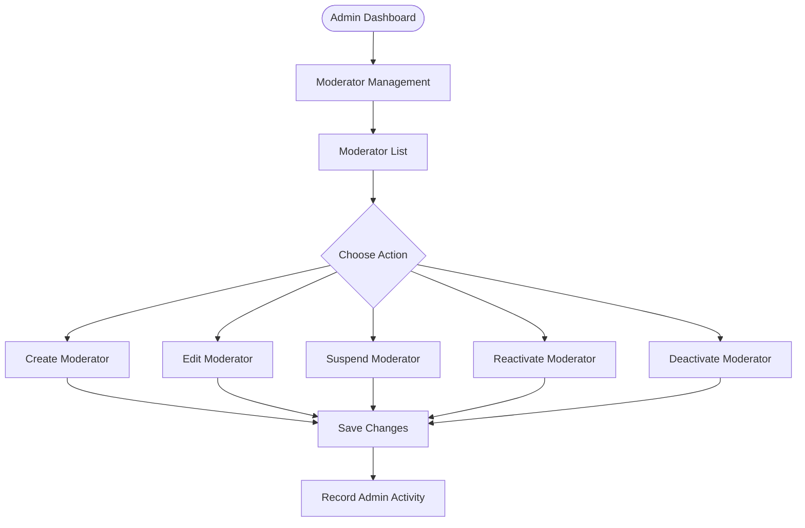

### Moderator management rules

- Admin can create moderator accounts.
- Admin can update moderator profile information.
- Admin can suspend or reactivate accounts.
- Admin can deactivate accounts.
- Suspended or deactivated accounts must not access protected dashboard routes.
- Admin actions must be recorded in activity logs.

## 7.3 Admin Content Management Flow

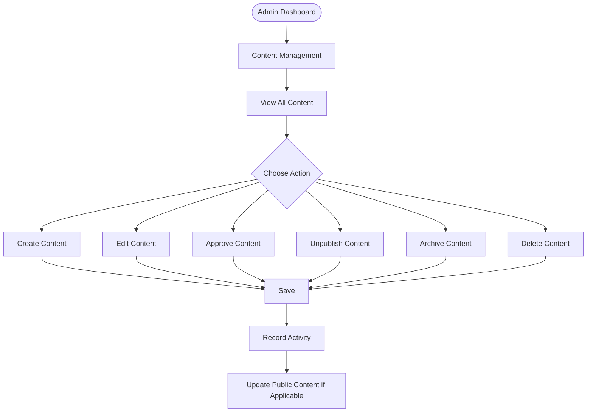

Admin has management access to all content.

Any action that changes public visibility must update the public website accordingly.

## 7.4 Scam Alert Management Flow

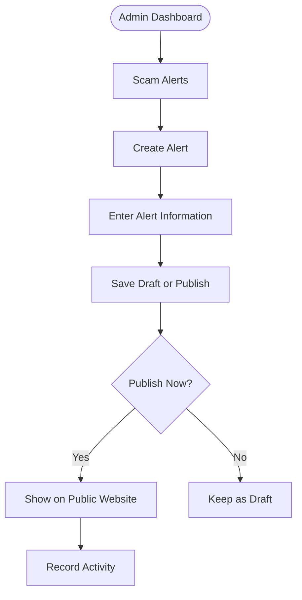

Admin can edit, unpublish, and archive existing alerts.

---

# 8. Moderator Presence Flow

The system maintains two separate status types.

## 8.1 Online / Offline

This is automatically controlled by the system.

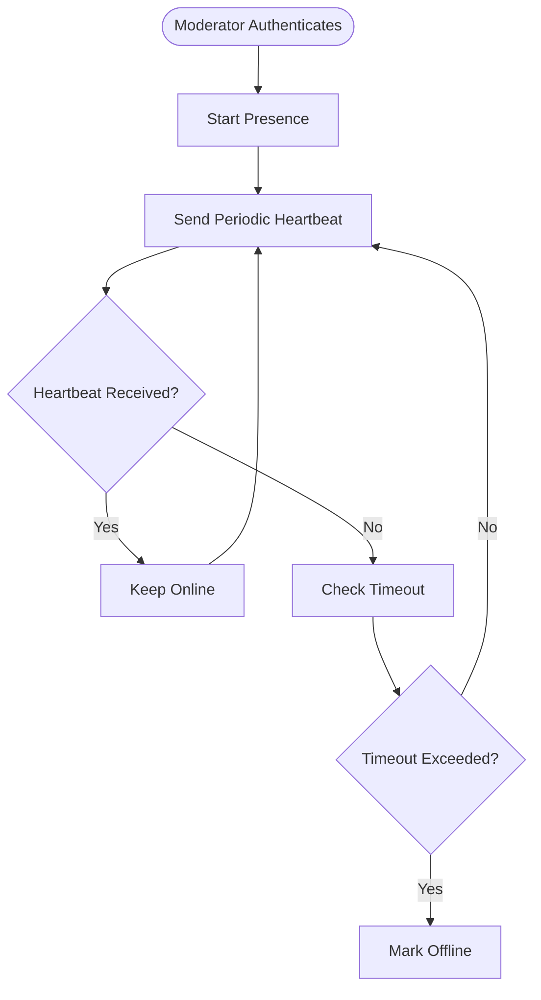

Presence should account for:
- Active authenticated sessions.
- Heartbeat timestamps.
- Configured inactivity timeout.
- Logout events.
- Expired or revoked sessions.

## 8.2 Available / Busy

This is manually controlled.

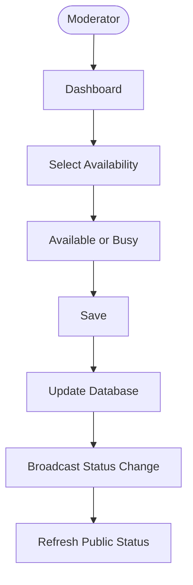

## 8.3 Status Display Rules

| Online Status | Availability | Public Display |
|---|---|---|
| Online | Available | Online · Available |
| Online | Busy | Online · Busy |
| Offline | Available | Offline · Available |
| Offline | Busy | Offline · Busy |

The interface must not interpret Available as Online.

---

# 9. Content Lifecycle

All public content must follow a controlled lifecycle.

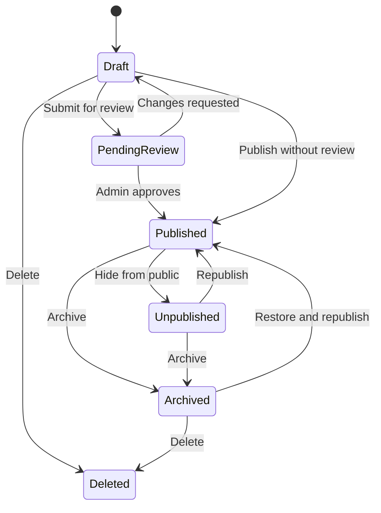

### Content states

- Draft: Not publicly visible.
- Pending Review: Awaiting admin approval.
- Published: Publicly visible and permitted.
- Unpublished: Hidden from public.
- Archived: Retained but not publicly visible.
- Deleted: Removed according to the application's deletion policy.

The exact transitions available to moderators will depend on the permissions defined in the technical and authorization specifications.

---

# 10. Language Switching Flow

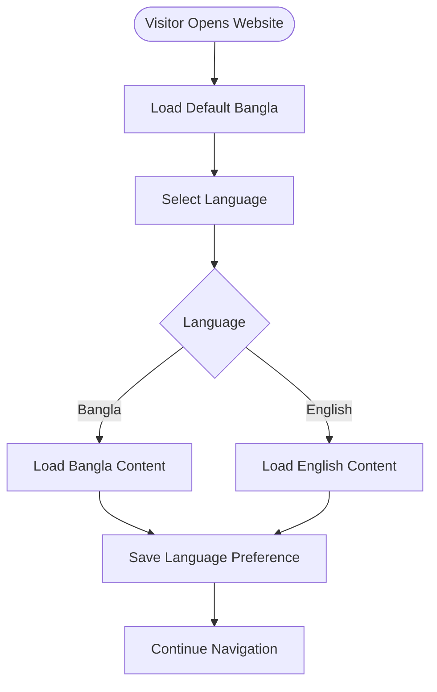

Language preference should persist across page navigation and subsequent visits according to the selected persistence strategy.

---

# 11. Access Control Summary

| Feature | Visitor | Moderator | Admin |
|---|---|---|---|
| View homepage | Yes | Yes | Yes |
| View public content | Yes | Yes | Yes |
| View moderator directory | Yes | Yes | Yes |
| View moderator details | Yes | Yes | Yes |
| Log in | No | Yes | Yes |
| Create content | No | Own content | Yes |
| Edit content | No | Own content | Yes |
| Delete/archive content | No | Own content, subject to policy | Yes |
| Change availability | No | Own status | Admin-controlled override if required |
| Manage moderators | No | No | Yes |
| View all activity logs | No | No | Yes |
| Manage scam alerts | No | No | Yes |
| Manage website settings | No | No | Yes |

All access permissions must be enforced by the backend.

---

# 12. Error and Edge Case Flows

The application must handle these situations gracefully.

### 12.1 Moderator Account Suspended

- Current protected access must be revoked.
- The moderator must be prevented from logging in again.
- Public profile visibility follows admin configuration.
- Existing content must remain manageable by Admin.

### 12.2 Moderator Goes Offline

- The presence system marks the moderator offline after the configured timeout.
- The public directory updates the status.
- Their content remains publicly visible if it is still published and permitted.

### 12.3 Content Becomes Unavailable

- The item must no longer be counted as available.
- Public content status must update.
- The system must not display stale availability counts.

### 12.4 Content Is Deleted

- The content must disappear from public listings.
- Related counts must update.
- The action must be logged.
- Soft deletion should be considered to preserve auditability.

### 12.5 Unauthorized Access

- Visitors attempting to access dashboard routes must be redirected to login.
- Moderators attempting to access admin-only routes must receive an authorization error.
- Moderators attempting to access another moderator's records must be denied.
- Authorization failures should not expose private record details.

### 12.6 Empty States

The application should provide helpful empty states when:

- No moderators are available.
- No public content exists.
- A moderator has no published content.
- A search returns no results.
- No activity has been recorded yet.

---

# 13. Navigation and UX Rules

1. The public website must have consistent primary navigation.
2. IDs / Content and Moderators must be easy to find.
3. Moderator cards must make status information easy to understand.
4. Moderator details must show profile information before content.
5. Dashboard navigation must be role-specific.
6. Destructive actions must require confirmation.
7. Forms must show clear validation errors.
8. Loading, success, error, and empty states must be designed.
9. The mobile navigation must remain simple and usable.
10. Language switching must not unexpectedly reset the visitor's current page.

---

# 14. Compliance Restrictions

The application flow intentionally does not define an operational account-trading workflow.

The following must remain excluded until compliance approval is documented:

- Account-sale listing publication.
- Account purchase actions.
- Account-transfer negotiation through WhatsApp.
- Payment and transaction flows for account transfers.
- Any other feature whose purpose is to facilitate prohibited account transfers.

If compliance is resolved in the future, the PRD, App Flow, technical requirements, and testing documents must be reviewed and updated before implementation.

---

# 15. Document Completion Checklist

- [x] Public website navigation defined.
- [x] IDs / content browsing flow defined.
- [x] Moderator directory flow defined.
- [x] Moderator details flow defined.
- [x] Moderator authentication flow defined.
- [x] Moderator dashboard flow defined.
- [x] Admin authentication flow defined.
- [x] Admin dashboard flow defined.
- [x] Content management flow defined.
- [x] Online/offline presence flow defined.
- [x] Available/busy flow defined.
- [x] Content lifecycle defined.
- [x] Language switching flow defined.
- [x] Role-based access summary defined.
- [x] Error and edge cases documented.
- [x] Compliance restrictions documented.

**End of Document — 02_App_Flow.md**