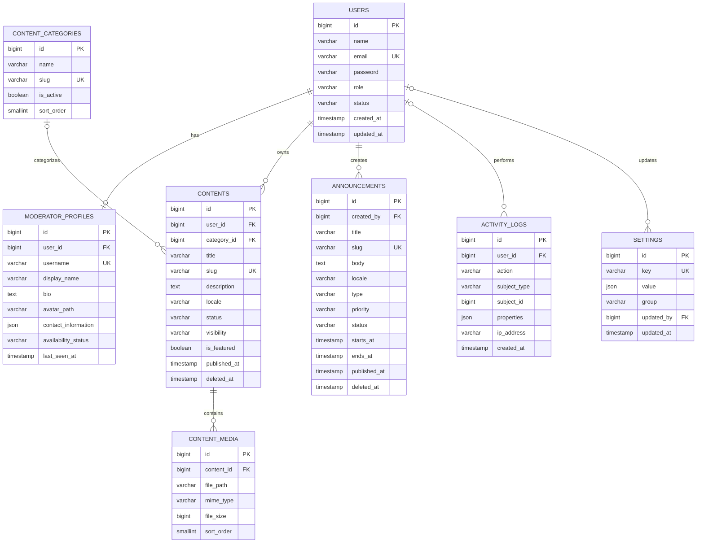

# 05 — Database Schema and Relationship Design

**Project:** Gaming Creator Community Website  
**Document:** Database Schema and Relationship Design  
**Version:** 1.0  
**Status:** Draft — Pending Database Review  
**Database:** MySQL 8.0+  
**Framework:** Laravel  
**Related Documents:** `01_PRD.md`, `02_App_Flow.md`, `03_UI_Spec.md`, `04_TRD.md`

---

## 1. Purpose

This document defines the proposed relational database structure for the MVP.

It describes:

- Database tables and columns.
- Data types and nullability.
- Primary and foreign keys.
- Entity relationships.
- Indexes and unique constraints.
- Status values and business rules.
- Soft-delete and retention policies.
- Example records.
- Entity relationship diagram.
- Laravel migration considerations.

The database must support two management roles: Admin and Moderator. Public visitors do not need accounts.

**Important scope restriction:** No tables or relationships are defined for Free Fire account sales, account transfers, transfer pricing, purchases, payments, escrow, or WhatsApp account-sale facilitation. Such functionality remains excluded pending compliance verification.

---

## 2. Database Design Principles

1. Use MySQL with the InnoDB storage engine.
2. Use `BIGINT UNSIGNED` primary keys for application entities.
3. Use Laravel-compatible naming conventions.
4. Use foreign keys to maintain referential integrity.
5. Add indexes to frequently filtered and joined columns.
6. Store timestamps consistently in UTC.
7. Keep authentication credentials separate from public profile information.
8. Store only information needed by the MVP.
9. Use database transactions for operations involving multiple related records.
10. Avoid storing values that can be calculated reliably from existing records.

### 2.1 Naming conventions

| Item | Convention | Example |
|---|---|---|
| Tables | Plural snake_case | `moderator_profiles` |
| Columns | Snake_case | `last_seen_at` |
| Primary key | `id` | `BIGINT UNSIGNED` |
| Foreign key | `{entity}_id` | `user_id` |
| Timestamps | Laravel convention | `created_at`, `updated_at` |
| Boolean columns | `is_` prefix | `is_featured` |
| Slugs | Lowercase URL-friendly strings | `gaming-tips` |

### 2.2 Common column conventions

Unless specified otherwise:

- `id`: `BIGINT UNSIGNED NOT NULL AUTO_INCREMENT`
- `created_at`: `TIMESTAMP NULL`
- `updated_at`: `TIMESTAMP NULL`
- Foreign keys: `BIGINT UNSIGNED`
- Boolean values: `BOOLEAN NOT NULL DEFAULT ...`
- Status values: `VARCHAR` with application-level validation and constants.

Use Laravel's standard `$table->id()`, `$table->timestamps()`, and `$table->foreignId()` migration methods where appropriate.

---

## 3. Entity Overview

The proposed MVP contains the following tables:

| Table | Purpose |
|---|---|
| `users` | Admin and Moderator authentication and account status |
| `moderator_profiles` | Public moderator information and presence data |
| `content_categories` | Categories for permitted gaming content |
| `contents` | Public gaming-related content and publication workflow |
| `content_media` | Images and media associated with content |
| `announcements` | Public announcements and scam-awareness notices |
| `activity_logs` | Important management activity history |
| `settings` | General application configuration |
| `password_reset_tokens` | Laravel password reset support |
| `sessions` | Database-backed sessions, if selected |

Laravel's standard migration, queue, cache, and job tables should only be added when the corresponding infrastructure is selected. They are not all mandatory application-domain tables.

---

## 4. Table Definitions

### 4.1 `users`

Stores Admin and Moderator accounts.

| Column | Type | Null | Default | Description |
|---|---|---:|---|---|
| `id` | BIGINT UNSIGNED | No | Auto | Primary key |
| `name` | VARCHAR(150) | No | — | Management account name |
| `email` | VARCHAR(191) | No | — | Unique login email |
| `email_verified_at` | TIMESTAMP | Yes | NULL | Email verification timestamp |
| `password` | VARCHAR(255) | No | — | Hashed password |
| `role` | VARCHAR(20) | No | — | `admin` or `moderator` |
| `status` | VARCHAR(20) | No | `active` | Account status |
| `remember_token` | VARCHAR(100) | Yes | NULL | Remember-me token |
| `created_at` | TIMESTAMP | Yes | NULL | Creation timestamp |
| `updated_at` | TIMESTAMP | Yes | NULL | Last update timestamp |

**Primary key:** `id`

**Unique constraints:**
- `email`

**Indexes:**
- `role`
- `status`
- Composite index: (`role`, `status`)

**Allowed roles:**

- `admin`
- `moderator`

**Allowed account statuses:**

- `active`
- `suspended`
- `deactivated`

**Rules:**

- Only Admin and Moderator accounts are stored here.
- There is no public registration.
- Passwords must be hashed using Laravel's supported hashing mechanism.
- A suspended or deactivated account must not access protected management routes.
- Account status must be checked on protected requests, not only during login.
- Do not store public profile biography or social links in this table.

The first Admin account should be created through a secure seeder or controlled deployment process. Do not provide a public Admin registration route.

### 4.2 `moderator_profiles`

Stores public profile information and presence data for Moderator accounts.

Each moderator has one profile.

| Column | Type | Null | Default | Description |
|---|---|---:|---|---|
| `id` | BIGINT UNSIGNED | No | Auto | Primary key |
| `user_id` | BIGINT UNSIGNED | No | — | Related user |
| `username` | VARCHAR(60) | No | — | Public profile identifier |
| `display_name` | VARCHAR(120) | No | — | Public display name |
| `bio` | TEXT | Yes | NULL | Public biography |
| `avatar_path` | VARCHAR(255) | Yes | NULL | Stored avatar path |
| `contact_information` | JSON | Yes | NULL | Approved public contact details |
| `availability_status` | VARCHAR(20) | No | `available` | Manual availability |
| `last_seen_at` | TIMESTAMP | Yes | NULL | Latest heartbeat |
| `created_at` | TIMESTAMP | Yes | NULL | Creation timestamp |
| `updated_at` | TIMESTAMP | Yes | NULL | Last update timestamp |

**Primary key:** `id`

**Foreign key:**

- `user_id` → `users.id`
- On user deletion: `RESTRICT` or controlled account removal after dependent records are handled.

**Unique constraints:**

- `user_id`
- `username`

**Indexes:**

- `availability_status`
- `last_seen_at`

**Allowed availability values:**

- `available`
- `busy`

**Rules:**

- Only Moderator accounts should have moderator profiles.
- The Admin account does not need a moderator profile.
- `username` is used for the public moderator profile URL.
- `availability_status` is manually controlled by the moderator.
- `last_seen_at` is updated by the authenticated heartbeat endpoint.
- Online/offline must be calculated from `last_seen_at` and the configured timeout. Do not store online/offline as a manually editable status.
- `contact_information` may contain only contact details approved for public display. Validate its structure and allowed fields in the application.
- Never store private authentication information in this table.

**Important:** A moderator can be Available while Offline. Availability and online presence are separate values.

### 4.3 `content_categories`

Stores categories for permitted gaming-related public content.

| Column | Type | Null | Default | Description |
|---|---|---:|---|---|
| `id` | BIGINT UNSIGNED | No | Auto | Primary key |
| `name` | VARCHAR(120) | No | — | Category name |
| `slug` | VARCHAR(150) | No | — | Unique URL-friendly identifier |
| `description` | TEXT | Yes | NULL | Optional description |
| `is_active` | BOOLEAN | No | TRUE | Whether category can be selected |
| `sort_order` | SMALLINT UNSIGNED | No | 0 | Display order |
| `created_at` | TIMESTAMP | Yes | NULL | Creation timestamp |
| `updated_at` | TIMESTAMP | Yes | NULL | Last update timestamp |

**Primary key:** `id`

**Unique constraints:**

- `slug`

**Indexes:**

- `is_active`
- `sort_order`

**Rules:**

- Admin manages categories.
- Inactive categories cannot be assigned to new content.
- Existing content may retain its category when that category becomes inactive.
- Categories should be seeded with initial approved values.

### 4.4 `contents`

Stores permitted gaming-related public content and its publication workflow.

| Column | Type | Null | Default | Description |
|---|---|---:|---|---|
| `id` | BIGINT UNSIGNED | No | Auto | Primary key |
| `user_id` | BIGINT UNSIGNED | No | — | Owning moderator |
| `category_id` | BIGINT UNSIGNED | Yes | NULL | Optional category |
| `title` | VARCHAR(180) | No | — | Content title |
| `slug` | VARCHAR(191) | No | — | Unique URL identifier |
| `description` | TEXT | Yes | NULL | Content description |
| `locale` | VARCHAR(5) | No | `bn` | Content language |
| `status` | VARCHAR(25) | No | `draft` | Publication workflow state |
| `visibility` | VARCHAR(20) | No | `public` | Public or private visibility |
| `is_featured` | BOOLEAN | No | FALSE | Homepage feature flag |
| `published_at` | TIMESTAMP | Yes | NULL | Publication timestamp |
| `created_at` | TIMESTAMP | Yes | NULL | Creation timestamp |
| `updated_at` | TIMESTAMP | Yes | NULL | Last update timestamp |
| `deleted_at` | TIMESTAMP | Yes | NULL | Soft-delete timestamp |

**Primary key:** `id`

**Foreign keys:**

- `user_id` → `users.id`
- `category_id` → `content_categories.id`

**Foreign-key behavior:**

- `user_id`: Restrict physical deletion while content exists. Use controlled account deactivation instead of deleting an owner with dependent records.
- `category_id`: Set NULL if a category is permanently removed, or preferably deactivate categories instead.

**Unique constraints:**

- `slug`

**Indexes:**

- `user_id`
- `category_id`
- `status`
- `visibility`
- `published_at`
- `is_featured`
- Composite index: (`status`, `visibility`, `published_at`)
- Composite index: (`user_id`, `status`, `visibility`)

**Allowed status values:**

- `draft`
- `pending_review`
- `published`
- `unpublished`
- `archived`

**Allowed visibility values:**

- `public`
- `private`

**Allowed locale values:**

- `bn`
- `en`

**Rules:**

1. A moderator owns the content they create.
2. A moderator can manage only their own content.
3. Admin can manage all permitted content.
4. Content submitted for review uses `pending_review`.
5. Only Admin-approved content may be published if the review workflow is enabled.
6. Public pages must return only content where:
   - `status = published`
   - `visibility = public`
   - `deleted_at IS NULL`
7. `published_at` must be set when content is published.
8. Unpublishing content must remove it from public listings.
9. A featured item must still satisfy all public visibility and publication rules.
10. Content counts on moderator cards must use the same public-content conditions.

Do not add fields for account sale prices, transfer details, purchase actions, payment status, or buyer/seller information.

### 4.5 `content_media`

Stores media files associated with permitted content.

This table supports one or more images per content item without placing multiple file paths in a single database column.

| Column | Type | Null | Default | Description |
|---|---|---:|---|---|
| `id` | BIGINT UNSIGNED | No | Auto | Primary key |
| `content_id` | BIGINT UNSIGNED | No | — | Related content |
| `file_path` | VARCHAR(255) | No | — | Stored file path |
| `alt_text` | VARCHAR(180) | Yes | NULL | Accessible image description |
| `mime_type` | VARCHAR(100) | No | — | Verified MIME type |
| `file_size` | BIGINT UNSIGNED | No | — | File size in bytes |
| `sort_order` | SMALLINT UNSIGNED | No | 0 | Display order |
| `created_at` | TIMESTAMP | Yes | NULL | Creation timestamp |
| `updated_at` | TIMESTAMP | Yes | NULL | Last update timestamp |

**Primary key:** `id`

**Foreign key:**

- `content_id` → `contents.id`
- On content hard deletion: `CASCADE`

**Indexes:**

- `content_id`
- Composite index: (`content_id`, `sort_order`)

**Rules:**

- Validate actual file content and MIME type on upload.
- Restrict allowed formats to approved image formats.
- Enforce upload size limits.
- Generate safe filenames.
- Store paths, not binary file data.
- Delete corresponding physical files when records are permanently removed.
- Do not permit executable uploads.

### 4.6 `announcements`

Stores public announcements and scam-awareness notices.

| Column | Type | Null | Default | Description |
|---|---|---:|---|---|
| `id` | BIGINT UNSIGNED | No | Auto | Primary key |
| `created_by` | BIGINT UNSIGNED | No | — | Admin who created it |
| `title` | VARCHAR(180) | No | — | Announcement title |
| `slug` | VARCHAR(191) | No | — | Unique identifier |
| `body` | TEXT | No | — | Announcement content |
| `locale` | VARCHAR(5) | No | `bn` | Content language |
| `type` | VARCHAR(25) | No | `announcement` | Notice classification |
| `priority` | VARCHAR(15) | No | `normal` | Display priority |
| `status` | VARCHAR(20) | No | `draft` | Publication status |
| `starts_at` | TIMESTAMP | Yes | NULL | Optional display start |
| `ends_at` | TIMESTAMP | Yes | NULL | Optional display end |
| `published_at` | TIMESTAMP | Yes | NULL | Publication timestamp |
| `created_at` | TIMESTAMP | Yes | NULL | Creation timestamp |
| `updated_at` | TIMESTAMP | Yes | NULL | Last update timestamp |
| `deleted_at` | TIMESTAMP | Yes | NULL | Soft-delete timestamp |

**Primary key:** `id`

**Foreign key:**

- `created_by` → `users.id`
- Restrict deletion while referenced; preserve the Admin account or use an explicit retention strategy.

**Unique constraints:**

- `slug`

**Indexes:**

- `type`
- `priority`
- `status`
- `published_at`
- Composite index: (`status`, `starts_at`, `ends_at`)

**Allowed type values:**

- `announcement`
- `scam_alert`
- `safety_notice`

**Allowed priority values:**

- `low`
- `normal`
- `high`
- `urgent`

**Allowed status values:**

- `draft`
- `published`
- `unpublished`
- `archived`

**Rules:**

- Only Admin can create and manage announcements.
- Only published notices within their optional display window should appear publicly.
- `starts_at` and `ends_at` are optional.
- When both are provided, `ends_at` must be later than `starts_at`.
- Urgent notices should be visually distinguished by the UI.
- Never treat a draft or unpublished notice as public.

### 4.7 `activity_logs`

Stores important actions performed by authenticated management users.

| Column | Type | Null | Default | Description |
|---|---|---:|---|---|
| `id` | BIGINT UNSIGNED | No | Auto | Primary key |
| `user_id` | BIGINT UNSIGNED | Yes | NULL | Actor account |
| `action` | VARCHAR(100) | No | — | Action identifier |
| `subject_type` | VARCHAR(150) | Yes | NULL | Target model type |
| `subject_id` | BIGINT UNSIGNED | Yes | NULL | Target model ID |
| `description` | VARCHAR(500) | Yes | NULL | Human-readable summary |
| `properties` | JSON | Yes | NULL | Non-sensitive metadata |
| `ip_address` | VARCHAR(45) | Yes | NULL | IPv4 or IPv6 address |
| `created_at` | TIMESTAMP | No | Current timestamp | Event time |

**Primary key:** `id`

**Foreign key:**

- `user_id` → `users.id`
- On user deletion: `SET NULL`

**Indexes:**

- `user_id`
- `action`
- `created_at`
- Composite index: (`subject_type`, `subject_id`)
- Composite index: (`user_id`, `created_at`)

**Rules:**

- Activity logs are append-only through normal application workflows.
- Do not expose activity logs publicly.
- Admin can view activity logs.
- Do not store passwords, tokens, session IDs, secrets, or full sensitive request payloads.
- Use controlled action identifiers, such as:
  - `auth.login`
  - `auth.logout`
  - `content.created`
  - `content.updated`
  - `content.published`
  - `content.unpublished`
  - `content.deleted`
  - `moderator.availability_changed`
  - `moderator.suspended`
  - `moderator.reactivated`
  - `announcement.published`
  - `settings.updated`

`subject_type` and `subject_id` form a polymorphic reference. Because a normal foreign key cannot enforce every possible target table, the application must validate the referenced entity. If strict referential integrity is preferred later, replace this approach with dedicated audit-target tables or explicit nullable foreign keys.

### 4.8 `settings`

Stores general application configuration.

| Column | Type | Null | Default | Description |
|---|---|---:|---|---|
| `id` | BIGINT UNSIGNED | No | Auto | Primary key |
| `key` | VARCHAR(120) | No | — | Unique setting key |
| `value` | JSON | Yes | NULL | Setting value |
| `group` | VARCHAR(80) | No | `general` | Setting category |
| `updated_by` | BIGINT UNSIGNED | Yes | NULL | Last Admin who updated it |
| `created_at` | TIMESTAMP | Yes | NULL | Creation timestamp |
| `updated_at` | TIMESTAMP | Yes | NULL | Last update timestamp |

**Primary key:** `id`

**Foreign key:**

- `updated_by` → `users.id`
- On user deletion: `SET NULL`

**Unique constraints:**

- `key`

**Indexes:**

- `group`

**Possible settings:**

- `site_name`
- `site_logo_path`
- `default_locale`
- `supported_locales`
- `presence_timeout_seconds`
- `heartbeat_interval_seconds`
- `public_contact_links`
- `social_links`
- `homepage_safety_notice_enabled`

**Rules:**

- Only Admin can update application settings.
- Validate setting values by key and expected type.
- Do not store passwords, API keys, or other secrets in this table.
- Environment-specific secrets belong in environment variables.

### 4.9 `password_reset_tokens`

Use Laravel's standard password reset table if password reset functionality is enabled.

| Column | Type | Null | Description |
|---|---|---:|---|
| `email` | VARCHAR(191) | No | Account email |
| `token` | VARCHAR(255) | No | Hashed reset token |
| `created_at` | TIMESTAMP | Yes | Token creation time |

**Primary/index:** `email`

Use Laravel's standard migration and password broker behavior. Never store a plaintext reset token.

### 4.10 `sessions` (Optional)

Use Laravel's standard sessions table only if the application selects the database session driver.

The table should follow the Laravel version's published session migration rather than a manually invented schema.

Session records must be protected from public access. Session identifiers and payloads must never be written into activity logs.

---

## 5. Entity Relationships

| Parent | Child | Relationship | Rule |
|---|---|---|---|
| users | moderator_profiles | One-to-one | A Moderator has one profile |
| users | contents | One-to-many | A Moderator owns multiple content records |
| content_categories | contents | One-to-many | A category can classify multiple records |
| contents | content_media | One-to-many | Content can have multiple media files |
| users | announcements | One-to-many | An Admin can create multiple notices |
| users | activity_logs | One-to-many | A user can generate multiple audit records |
| users | settings | One-to-many | An Admin can update multiple settings |

### 5.1 Important ownership rule

The `contents.user_id` value represents the owning Moderator.

Every moderator content update, delete, and management query must verify that the authenticated user's ID matches the content's owner ID, unless the authenticated user is an Admin.

Do not rely on hiding buttons in Blade as an authorization mechanism.

---

## 6. Entity Relationship Diagram



---

## 7. Status and Business Rules

### 7.1 User account status

| Status | Management access |
|---|---|
| `active` | Allowed according to role |
| `suspended` | Denied |
| `deactivated` | Denied |

Suspended and deactivated accounts must be rejected by middleware or an equivalent protected-request check.

### 7.2 Moderator presence

Do not add an `online_status` column.

Calculate online status using:

`last_seen_at >= current_time - configured_timeout`

Conceptual logic:

```php
$isOnline = $profile->last_seen_at !== null
    && $profile->last_seen_at->greaterThanOrEqualTo(
        now()->subSeconds($presenceTimeout)
    );
```

This is illustrative application logic. The actual implementation should use a dedicated presence service or reusable query logic.

A moderator with no recent heartbeat is Offline, regardless of their manually selected availability.

### 7.3 Content publication

Public content query conditions:

```sql
status = 'published'
AND visibility = 'public'
AND deleted_at IS NULL
```

For moderator public content count, additionally filter by the moderator's user ID.

### 7.4 Content lifecycle

```text
Draft
  |
  v
Pending Review
  |
  v
Published
  |
  +----> Unpublished
  |
  +----> Archived
  |
  +----> Deleted (soft delete)
```

Admin may approve and publish content. The exact transition permissions should be enforced by policies and application services.

### 7.5 Announcement visibility

A notice is publicly visible only when:

- `status = published`
- `deleted_at IS NULL`
- `starts_at IS NULL OR starts_at <= current_time`
- `ends_at IS NULL OR ends_at >= current_time`

The application should use a consistent timezone strategy for these comparisons.

---

## 8. Soft Delete and Data Retention

| Table | Soft delete? | Retention approach |
|---|---|---|
| users | No | Suspend or deactivate accounts |
| moderator_profiles | No | Retain while account exists |
| content_categories | No | Deactivate instead of deleting |
| contents | Yes | Retain recoverable records |
| content_media | No | Delete when permanently removed |
| announcements | Yes | Retain recoverable notices |
| activity_logs | No | Append-only with controlled retention |
| settings | No | Update existing records |
| password_reset_tokens | No | Expire and remove old tokens |
| sessions | No | Use Laravel session expiration and cleanup |

### 8.1 Activity log retention

The exact retention duration requires project-owner approval.

Proposed approach:

- Keep activity logs for a defined operational period.
- Restrict access to Admin.
- Archive or permanently remove old records according to the approved retention policy.
- Do not silently remove audit records during normal content deletion.

### 8.2 Account removal

Prefer deactivation over deleting a management account.

If legal or operational requirements later require permanent deletion, define how owned content, activity logs, and public profile information are retained or anonymized before implementing it.

---

## 9. Example Records

The following records are illustrative and use fictional values.

### 9.1 `users`

| id | name | email | role | status |
|---:|---|---|---|---|
| 1 | Site Administrator | admin@example.test | admin | active |
| 2 | Moderator One | moderator1@example.test | moderator | active |
| 3 | Moderator Two | moderator2@example.test | moderator | active |

Passwords are omitted. Real password values must be hashed.

### 9.2 `moderator_profiles`

| id | user_id | username | display_name | availability_status |
|---:|---:|---|---|---|
| 1 | 2 | moderator-one | Moderator One | available |
| 2 | 3 | moderator-two | Moderator Two | busy |

`last_seen_at` is updated by heartbeat requests and determines online/offline presence.

### 9.3 `content_categories`

| id | name | slug | is_active |
|---:|---|---|---:|
| 1 | Gaming Tips | gaming-tips | 1 |
| 2 | Community Updates | community-updates | 1 |
| 3 | Gameplay Highlights | gameplay-highlights | 1 |

### 9.4 `contents`

| id | user_id | category_id | title | locale | status | visibility |
|---:|---:|---:|---|---|---|---|
| 1 | 2 | 1 | Beginner Gameplay Tips | en | published | public |
| 2 | 2 | 3 | Weekly Gameplay Highlights | en | pending_review | public |
| 3 | 3 | 2 | Community Update | bn | published | public |

Only records 1 and 3 are eligible for public display, assuming they are not soft-deleted and their publication dates are valid.

### 9.5 `announcements`

| id | created_by | title | type | priority | status |
|---:|---:|---|---|---|---|
| 1 | 1 | Stay Safe Online | safety_notice | urgent | published |
| 2 | 1 | Community News | announcement | normal | published |

---

## 10. Laravel Migration Plan

Create migrations in dependency order.

Recommended order:

1. Laravel authentication tables and `users`
2. `moderator_profiles`
3. `content_categories`
4. `contents`
5. `content_media`
6. `announcements`
7. `activity_logs`
8. `settings`
9. `password_reset_tokens`, if not already included
10. `sessions`, if database sessions are selected

### 10.1 Migration conventions

- Use `$table->id()` for primary keys.
- Use `$table->foreignId()` for foreign keys.
- Use `$table->timestamps()` for standard timestamps.
- Use `$table->softDeletes()` for soft-deletable tables.
- Use `$table->json()` for structured JSON data.
- Add indexes explicitly.
- Define foreign-key deletion behavior intentionally.
- Do not edit old production migrations after deployment; create new migrations for schema changes.

### 10.2 Example migration: moderator profiles

```php
Schema::create('moderator_profiles', function (Blueprint $table) {
    $table->id();

    $table->foreignId('user_id')
        ->unique()
        ->constrained()
        ->restrictOnDelete();

    $table->string('username', 60)->unique();
    $table->string('display_name', 120);
    $table->text('bio')->nullable();
    $table->string('avatar_path')->nullable();
    $table->json('contact_information')->nullable();

    $table->string('availability_status', 20)
        ->default('available');

    $table->timestamp('last_seen_at')->nullable();

    $table->timestamps();

    $table->index('availability_status');
    $table->index('last_seen_at');
});
```

This is an example migration fragment, not a complete migration file. Add the appropriate namespace, imports, class, and `down()` method in the actual project.

### 10.3 Example migration: contents

```php
Schema::create('contents', function (Blueprint $table) {
    $table->id();

    $table->foreignId('user_id')
        ->constrained()
        ->restrictOnDelete();

    $table->foreignId('category_id')
        ->nullable()
        ->constrained('content_categories')
        ->nullOnDelete();

    $table->string('title', 180);
    $table->string('slug', 191)->unique();
    $table->text('description')->nullable();

    $table->string('locale', 5)->default('bn');
    $table->string('status', 25)->default('draft');
    $table->string('visibility', 20)->default('public');

    $table->boolean('is_featured')->default(false);
    $table->timestamp('published_at')->nullable();

    $table->timestamps();
    $table->softDeletes();

    $table->index(['status', 'visibility', 'published_at']);
    $table->index(['user_id', 'status', 'visibility']);
    $table->index('is_featured');
});
```

### 10.4 Enum implementation decision

Use `VARCHAR` columns with Laravel validation and PHP enums or constants for the MVP rather than relying on database-specific ENUM definitions.

This keeps status changes easier to manage through migrations.

If database-level enforcement is required, evaluate MySQL CHECK constraints against the selected MySQL version and migration behavior.

---

## 11. Seeders and Initial Data

Recommended seeders:

- `AdminUserSeeder`
- `ContentCategorySeeder`
- `DefaultSettingsSeeder`

### 11.1 Admin seeding

- Create the first Admin account through a secure deployment process.
- Read credentials from protected environment variables or use a secure one-time setup procedure.
- Never commit real credentials to source control.
- Do not create a default publicly known production password.

### 11.2 Moderator seeding

Create moderator accounts through the Admin management panel or a controlled development seeder.

Each new Moderator account should receive a corresponding `moderator_profiles` record in the same database transaction.

### 11.3 Default settings

Suggested initial settings:

| Key | Example value |
|---|---|
| `default_locale` | `bn` |
| `supported_locales` | `["bn", "en"]` |
| `presence_timeout_seconds` | `180` |
| `heartbeat_interval_seconds` | `60` |
| `homepage_safety_notice_enabled` | `true` |

These values are initial proposals and should be adjustable by Admin where appropriate.

---

## 12. Query and Data Integrity Requirements

### 12.1 Public content

Use a reusable query scope or service for public content. Avoid repeating slightly different visibility conditions across controllers.

### 12.2 Moderator content ownership

Every moderator content query must be scoped to the authenticated moderator unless the user has Admin permissions.

### 12.3 Moderator public count

Use an aggregate query or Eloquent relationship count with the public publication conditions. Avoid loading all content records merely to calculate a count.

### 12.4 Presence queries

Use `last_seen_at` and the configured timeout. Do not write online/offline status into the database as a manually maintained value.

### 12.5 Transactions

Use database transactions for operations such as:

- Creating a moderator and their profile.
- Publishing content while recording its activity.
- Changing account status while recording the action.
- Updating settings and creating the corresponding activity record.

If a transaction fails, related database changes must roll back together.

Physical file deletion should be handled carefully because filesystem operations cannot be rolled back by a MySQL transaction.

---

## 13. Security and Privacy Considerations

- Never expose the `users.password` field.
- Do not expose reset tokens or session payloads.
- Keep activity logs behind Admin authorization.
- Validate all JSON structures before saving.
- Limit public contact information to fields explicitly approved for display.
- Do not expose private moderator account details on public profiles.
- Validate media uploads on the server.
- Do not accept arbitrary database column names or status values from client requests.
- Do not trust `user_id` submitted by a Moderator when creating or updating content; derive ownership from the authenticated account.
- Use policies and transactions for sensitive changes.
- Apply retention and deletion rules consistently.

---

## 14. Assumptions and Decisions Requiring Review

| Topic | Current proposal | Review status |
|---|---|---|
| Database | MySQL 8.0+ | Proposed |
| Primary keys | BIGINT UNSIGNED | Proposed |
| User roles | `admin`, `moderator` | Based on approved TRD |
| Moderator profile | One-to-one with user | Proposed |
| Content ownership | One owning moderator per content record | Based on approved TRD |
| Content categories | Admin-managed | Proposed |
| Content media | Separate media table | Proposed |
| Profile contact data | JSON with strict validation | Needs review |
| Online status | Derived from heartbeat timestamp | Based on approved TRD |
| Availability | `available` or `busy` | Based on approved TRD |
| Presence timeout | 180 seconds initially | Proposed |
| Heartbeat interval | 60 seconds initially | Proposed |
| Localization | Interface translations plus content locale | Proposed |
| Activity log target | Polymorphic reference | Proposed |
| Activity retention | Duration not yet decided | Pending |
| Sessions | Database driver only if selected | Pending |
| Password reset | Enable if required for management users | Pending |
| Content approval | Admin review before publication | Based on proposed workflow |

### 14.1 Localization assumption

Interface translations should use Laravel language files rather than a database table.

The `locale` column on content and announcements identifies the language of each record. It does not automatically create translated versions of the same record.

If the project later requires one moderator profile or one content item to have linked Bangla and English translations, introduce dedicated translation tables in a separate schema revision.

### 14.2 Contact information assumption

The JSON field is intended for a small, controlled set of public contact methods. If contact information becomes more complex, or each method needs independent visibility and verification, replace it with a normalized `moderator_contacts` table.

### 14.3 Activity log assumption

The polymorphic subject reference is convenient for a small Laravel application. It does not provide a normal database foreign key to every possible subject table. Application-level validation is required.

---

## 15. Database Acceptance Criteria

The schema is ready for implementation when:

- All required entities and relationships are approved.
- Every foreign key has a defined deletion strategy.
- Moderator ownership is enforceable.
- Public content queries have consistent rules.
- Presence is derived from heartbeat data.
- Availability remains a separate manual setting.
- Admin and Moderator roles are clearly defined.
- Announcement visibility rules are defined.
- Activity logs exclude secrets and credentials.
- Localization behavior is understood.
- Retention rules and unresolved assumptions are documented.
- No excluded account-transfer or sale-related functionality has been introduced.

---

## 16. Next Step

After reviewing and approving this document, prepare:

**`06_Implementation_Plan.md` — Implementation Roadmap**

It should divide development into practical phases:

1. Laravel project setup and configuration.
2. Database migrations and seeders.
3. Authentication and authorization.
4. Public website and localization.
5. Moderator profiles and presence.
6. Content management and review workflow.
7. Announcements and activity logs.
8. UI integration and responsive refinement.
9. Automated testing and security review.
10. Staging and production deployment.

**Document status:** Draft — Pending Database Review.