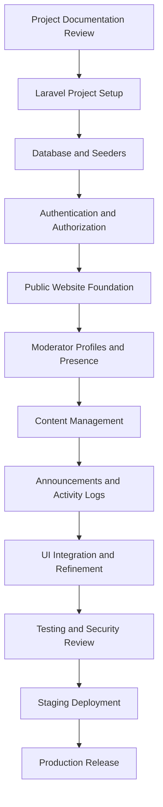
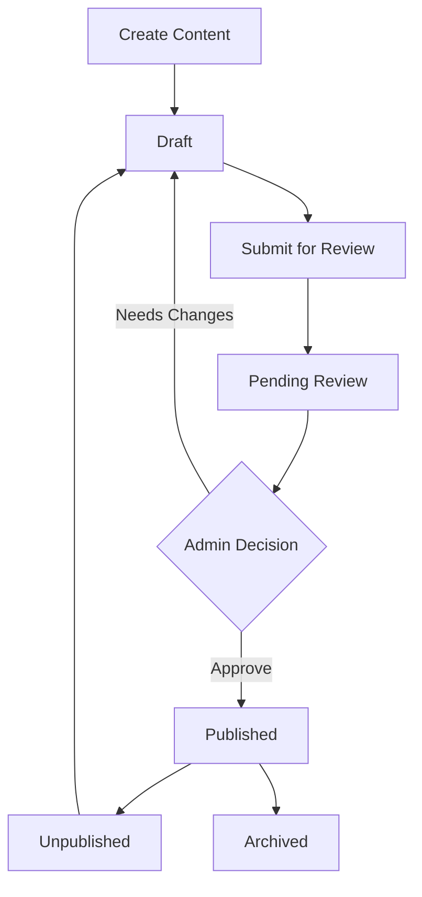

# 06 — Implementation Plan and Development Roadmap

**Project:** Gaming Creator Community Website  
**Document:** Implementation Plan  
**Version:** 1.0  
**Status:** Draft — Pending Project Review  
**Related Documents:**
- `01_PRD.md`
- `02_App_Flow.md`
- `03_UI_Spec.md`
- `04_TRD.md`
- `05_Database_Schema.md`

---

## 1. Purpose

This document defines the development roadmap for implementing the gaming creator community website using Laravel.

It divides the project into manageable phases, explains the implementation order, identifies dependencies, and establishes completion criteria.

Development should follow the approved requirements and design documents. The implementation must remain maintainable, secure, and suitable for future expansion.

### 1.1 Development objectives

- Establish a clean Laravel application foundation.
- Implement the database structure and relationships.
- Build secure Admin and Moderator authentication.
- Develop the public website according to UI Specification v2.0.
- Implement moderator profiles, presence, and availability.
- Build content management and publishing workflows.
- Implement announcements and activity logging.
- Complete testing, security review, and deployment preparation.

### 1.2 Development approach

Use an incremental development approach.

Each phase should produce a working and testable result before moving to the next phase.

Do not attempt to build the entire application in one large implementation task.

---

## 2. Project Development Sequence

The recommended development sequence is:



Some frontend components and backend foundations may be developed in parallel when their dependencies are clear. However, security-sensitive workflows must not be implemented before their authorization rules are established.

---

## 3. Phase 0 — Documentation and Project Preparation

**Goal:** Ensure the project requirements and technical decisions are sufficiently clear before coding.

### Tasks

- Review the PRD and confirm MVP scope.
- Review the App Flow and user journeys.
- Review UI Specification v2.0.
- Review the TRD and confirm the technical stack.
- Review the Database Schema and resolve blocking design questions.
- Confirm the initial brand assets and creator information.
- Confirm the initial content categories.
- Identify required social links and public contact information.
- Confirm hosting and deployment expectations.

### Deliverables

- Approved project requirements.
- Approved UI baseline.
- Approved technical architecture.
- Reviewed database schema.
- Initial project configuration decisions.

### Completion criteria

- No major unresolved requirement blocks implementation.
- Account-transfer and sale-related functionality remains excluded.
- The initial creator branding assets are available or clearly identified as pending.
- The development environment can be prepared consistently.

---

## 4. Phase 1 — Laravel Project Setup

**Goal:** Create a clean Laravel application foundation.

### Tasks

1. Create the Laravel project.
2. Configure the application name and environment.
3. Configure the MySQL database connection.
4. Install and configure Tailwind CSS through Vite.
5. Install Alpine.js only if required for lightweight interactions.
6. Configure application timezone and localization.
7. Configure storage and file upload directories.
8. Configure Git and `.gitignore`.
9. Create the initial folder structure.
10. Verify local development and asset compilation.

### Suggested project structure

```text
app/
├── Http/
│   ├── Controllers/
│   │   ├── Public/
│   │   ├── Admin/
│   │   ├── Moderator/
│   │   └── Auth/
│   ├── Middleware/
│   └── Requests/
├── Models/
├── Policies/
├── Services/
└── Support/

database/
├── migrations/
├── seeders/
└── factories/

resources/
├── css/
├── js/
└── views/
    ├── layouts/
    ├── components/
    ├── public/
    ├── admin/
    ├── moderator/
    └── auth/

routes/
├── web.php
└── console.php

tests/
├── Feature/
└── Unit/
```

This is a proposed structure, not a requirement to create empty directories for every possible module.

### Deliverables

- Working Laravel project.
- MySQL connection.
- Tailwind and Vite configuration.
- Git repository.
- Initial application layout.
- Environment configuration example.

### Completion criteria

- Laravel application runs locally.
- Database connection works.
- Vite compiles frontend assets.
- No environment secrets are committed.
- The project structure is understandable and maintainable.

---

## 5. Phase 2 — Database Migrations and Seeders

**Goal:** Implement the reviewed database design.

### Tasks

- Create the `users` table or adapt Laravel's default migration.
- Create `moderator_profiles`.
- Create `content_categories`.
- Create `contents`.
- Create `content_media`.
- Create `announcements`.
- Create `activity_logs`.
- Create `settings`.
- Configure password reset and session tables if selected.
- Add indexes and foreign keys.
- Add soft-delete support where specified.
- Create initial Admin and default settings seeders.
- Create initial content category seeders.
- Verify relationships using Eloquent.

### Suggested model relationships

| Model | Relationship |
|---|---|
| User | Has one ModeratorProfile |
| User | Has many Contents |
| ModeratorProfile | Belongs to User |
| Content | Belongs to User |
| Content | Belongs to ContentCategory |
| Content | Has many ContentMedia |
| ContentCategory | Has many Contents |
| Announcement | Belongs to Admin user |
| ActivityLog | Belongs to User, optionally |
| Setting | Belongs to updating Admin, optionally |

### Important implementation rules

- Do not manually create database tables outside Laravel migrations.
- Do not use production credentials in seeders.
- Create moderator accounts and profiles in a database transaction.
- Use foreign-key constraints consistently.
- Verify that rollback migrations work in development.

### Deliverables

- Database migrations.
- Eloquent models and relationships.
- Seeders and factories.
- Working initial database.

### Completion criteria

- All selected migrations run successfully.
- Database relationships work.
- Foreign keys and indexes exist.
- Seeders produce valid development data.
- No excluded marketplace or account-transfer tables are introduced.

---

## 6. Phase 3 — Authentication and Authorization

**Goal:** Build secure management access for Admin and Moderators.

### 6.1 Authentication tasks

- Implement login.
- Implement logout.
- Add session regeneration.
- Configure secure password hashing.
- Add login rate limiting.
- Add password reset if approved.
- Add account status checks.
- Redirect users according to their role.

### 6.2 Authorization tasks

Implement:

- Admin middleware.
- Moderator middleware.
- Account status verification.
- Content ownership policies.
- Admin-only management policies.
- Protected management routes.

### 6.3 Access control

| Feature | Admin | Moderator |
|---|---:|---:|
| Admin dashboard | Yes | No |
| Moderator dashboard | Optional | Yes |
| Manage moderator accounts | Yes | No |
| Manage all content | Yes | No |
| Manage own content | Yes | Yes |
| Manage another moderator's content | Yes | No |
| Change own availability | Yes, where applicable | Yes |
| Manage announcements | Yes | No |
| View all activity logs | Yes | No |
| Manage settings | Yes | No |

### Security requirements

- A hidden button is not authorization.
- Every protected action must be checked server-side.
- Moderator ownership must be verified for every content operation.
- Suspended or deactivated accounts must lose management access.
- Changing a URL or record ID must not bypass permissions.

### Deliverables

- Authentication pages.
- Admin and Moderator route groups.
- Middleware and policies.
- Secure role-based redirects.
- Authentication tests.

### Completion criteria

- Admin and Moderator can log in.
- Visitors cannot access protected routes.
- Moderators cannot manage another moderator's content.
- Suspended and deactivated accounts are denied access.
- Login and logout behave securely.

---

## 7. Phase 4 — Public Website Foundation

**Goal:** Implement the public-facing website based on the approved Brand-led Gaming Editorial design.

### 7.1 Shared layout

Implement:

- Header and navigation.
- Logo and creator branding.
- Language switcher.
- Responsive mobile navigation.
- Footer.
- Reusable typography and spacing styles.
- Shared buttons and interface components.

### 7.2 Homepage

Implement the homepage sections:

1. Hero section.
2. Scam-awareness announcement.
3. Featured permitted content.
4. Moderator introduction.
5. About the creator/community.
6. Safety information.
7. Social and contact links.
8. Footer.

Use actual creator assets when available.

### 7.3 Public content pages

Implement:

- Content listing page.
- Content detail page.
- Category filtering, if included in the approved MVP.
- Pagination.
- Empty states.
- Missing-content handling.

### 7.4 Moderator pages

Implement:

- Moderator directory.
- Moderator profile details.
- Profile biography and approved contact information.
- Online/offline indicator.
- Available/busy indicator.
- Public content list for each moderator.
- Public content count.

### 7.5 About and Contact

Implement the approved informational pages and public contact information.

Do not add public registration or customer dashboards.

### Deliverables

- Public Blade layouts.
- Reusable Blade components.
- Homepage.
- Public content pages.
- Moderator directory.
- Moderator details.
- About and Contact pages.
- Responsive navigation.

### Completion criteria

- Public pages load without authentication.
- Only published and public content appears.
- Moderator profiles display correct information.
- The public interface follows UI Specification v2.0.
- Bangla and English interface switching works.
- Mobile, tablet, and desktop layouts are usable.

---

## 8. Phase 5 — Moderator Profiles and Presence

**Goal:** Implement moderator profile management and presence indicators.

### 8.1 Profile management

Moderator can:

- Update display name.
- Update biography.
- Update avatar.
- Update approved public contact details.
- Review their public profile.

Admin can:

- View moderator profiles.
- Manage moderator accounts.
- Suspend or reactivate accounts.
- Review moderator information.

### 8.2 Availability management

Moderator can manually select:

- Available
- Busy

The selected value is stored in `moderator_profiles.availability_status`.

### 8.3 Online/offline presence

Implement a heartbeat mechanism.

Proposed initial configuration:

| Setting | Initial value |
|---|---:|
| Heartbeat interval | 60 seconds |
| Online timeout | 180 seconds |

Implementation:

1. Authenticated moderator pages send periodic heartbeat requests.
2. Laravel verifies authentication and account status.
3. The latest heartbeat timestamp is saved in `last_seen_at`.
4. Public pages calculate online/offline from the configured timeout.
5. Expired presence is displayed as Offline.

Do not rely on browser-side state alone to determine online status.

### 8.4 Realtime decision

Start with polling.

Evaluate Laravel Reverb only if the MVP needs immediate status updates without waiting for the next refresh interval.

### Deliverables

- Moderator profile editing.
- Avatar upload.
- Availability controls.
- Heartbeat endpoint.
- Presence calculation.
- Public presence indicators.

### Completion criteria

- Moderator profile updates work.
- Availability changes persist.
- Online status expires after the configured timeout.
- Offline moderators are never displayed as online indefinitely.
- Availability remains independent of online/offline status.

---

## 9. Phase 6 — Content Management

**Goal:** Build the permitted gaming-content publishing workflow.

### 9.1 Moderator features

- View own content list.
- Create content.
- Edit own content.
- Upload approved media.
- Save drafts.
- Submit content for review.
- View publication status.
- Unpublish or archive content where permitted.

### 9.2 Admin features

- View all content.
- Review pending content.
- Approve and publish content.
- Edit or unpublish content.
- Archive content.
- Review content ownership and metadata.

### 9.3 Content lifecycle



The exact transition permissions should follow the approved App Flow and policies.

### 9.4 Media handling

- Validate file formats.
- Validate file sizes.
- Generate safe filenames.
- Store media using Laravel Filesystem.
- Save metadata in `content_media`.
- Delete unused media safely.
- Use image fallbacks when files are missing.

### 9.5 Public integration

- Display only eligible public content.
- Display featured content on the homepage.
- Display content on the owning moderator's profile.
- Calculate public content counts using consistent query conditions.
- Implement pagination and empty states.

### Compliance boundary

The content module is for permitted gaming-related material. Do not implement Free Fire account-sale listings, account-transfer purchase actions, transfer prices, payments, escrow, or WhatsApp flows facilitating account transfers without verified authorization and a formally approved scope revision.

### Deliverables

- Content CRUD.
- Content categories.
- Media uploads.
- Admin review workflow.
- Publication controls.
- Public content integration.

### Completion criteria

- Moderators can manage their own content.
- Admin can manage all permitted content.
- Unauthorized ownership changes are rejected.
- Public visitors see only published and public records.
- Content media is validated and stored safely.
- Publication and content-count rules work correctly.

---

## 10. Phase 7 — Announcements and Activity Logs

**Goal:** Provide safety communication and management accountability.

### 10.1 Announcement management

Admin can:

- Create announcements.
- Edit announcements.
- Select notice type.
- Set priority.
- Publish and unpublish notices.
- Configure optional start and end dates.
- Archive old notices.

Notice types:

- Announcement
- Scam Alert
- Safety Notice

Priority values:

- Low
- Normal
- High
- Urgent

### 10.2 Public announcement display

- Display eligible published notices.
- Respect start and end dates.
- Show urgent notices prominently.
- Keep visual treatment consistent with the approved UI.
- Support Bangla and English content.

### 10.3 Activity logging

Record important actions:

- Login and logout.
- Content creation and updates.
- Content publication and unpublishing.
- Moderator availability changes.
- Moderator suspension and reactivation.
- Profile updates.
- Announcement publication.
- Application setting changes.

Do not log passwords, tokens, secrets, or sensitive request payloads.

### Deliverables

- Admin announcement management.
- Public announcement display.
- Activity log service.
- Admin activity log page.
- Retention policy configuration or documented operational process.

### Completion criteria

- Admin can manage notices.
- Public pages display only eligible notices.
- Important management actions are recorded.
- Activity logs are accessible only to authorized Admin users.
- Sensitive information is excluded.

---

## 11. Phase 8 — Dashboard and Management UI Refinement

**Goal:** Complete and refine the management interface.

### 11.1 Admin dashboard

Display useful operational information:

- Total moderators.
- Active moderators.
- Suspended/deactivated moderators.
- Total permitted content.
- Published content.
- Pending review content.
- Recent announcements.
- Recent activity.

Only display metrics that can be calculated reliably from the database.

### 11.2 Moderator dashboard

Display:

- Moderator profile summary.
- Availability control.
- Online/offline indicator.
- Own content totals.
- Published content.
- Draft content.
- Pending review content.
- Recent relevant activity.

### 11.3 UI refinement

- Confirm navigation consistency.
- Improve form validation feedback.
- Add loading and empty states.
- Add confirmation dialogs for destructive actions.
- Improve responsive layouts.
- Verify keyboard navigation.
- Verify contrast and typography.
- Use real brand artwork rather than generic placeholders.

### Completion criteria

- Dashboard information is accurate.
- Forms provide understandable feedback.
- Destructive actions require appropriate confirmation.
- Management interfaces are usable across supported screen sizes.
- The visual design remains consistent with UI Specification v2.0.

---

## 12. Phase 9 — Testing and Security Review

**Goal:** Verify that the application behaves correctly and securely.

### 12.1 Unit tests

Test important isolated business rules:

- Presence timeout calculation.
- Content publication eligibility.
- Moderator availability validation.
- Announcement display windows.
- Content count conditions.

### 12.2 Feature tests

Test:

- Public page access.
- Login and logout.
- Role-based route protection.
- Moderator ownership.
- Admin management permissions.
- Suspended account restrictions.
- Content lifecycle.
- Media upload validation.
- Announcement visibility.
- Activity logging.
- Localization.
- Settings updates.

### 12.3 Security review

Check:

- Authentication rate limiting.
- CSRF protection.
- XSS protection.
- SQL injection resistance through safe query practices.
- File upload validation.
- Unauthorized record access.
- Sensitive information exposure.
- Session security.
- Production error handling.

### 12.4 UI testing

Test on:

- Mobile.
- Tablet.
- Desktop.

Test both Bangla and English layouts.

### Deliverables

- Automated test suite.
- Test execution report.
- Security review checklist.
- List of resolved and outstanding defects.

### Completion criteria

- Critical tests pass.
- No known critical authorization bypass remains.
- Public content visibility is correct.
- Core workflows work across supported screen sizes.
- No unresolved critical security issue remains.

Detailed cases belong in `07_Testing_Plan.md`.

---

## 13. Phase 10 — Staging and Production Deployment

**Goal:** Deploy the application safely.

### 13.1 Staging deployment

- Configure staging environment variables.
- Deploy application code.
- Install production dependencies.
- Build frontend assets.
- Run migrations.
- Configure storage.
- Configure HTTPS.
- Verify authentication and authorization.
- Test public and management workflows.
- Review application logs.

### 13.2 Production deployment

- Configure production server.
- Configure Nginx and PHP-FPM.
- Configure MySQL.
- Configure HTTPS.
- Configure application secrets.
- Run reviewed migrations.
- Create initial Admin account securely.
- Configure file storage permissions.
- Configure scheduled tasks if needed.
- Configure queue workers if needed.
- Configure database backups.
- Verify the production application.

### 13.3 Post-deployment checks

- Homepage availability.
- Public content availability.
- Moderator profiles.
- Admin login.
- Moderator login.
- Content management.
- File uploads.
- Language switching.
- Activity logging.
- Backup operation.
- Error logging.

### Completion criteria

- Application works on staging.
- Production deployment is repeatable.
- HTTPS is enabled.
- Debug mode is disabled.
- Database backup process is operational.
- Critical public and management workflows are verified.

---

## 14. Suggested Development Milestones

| Milestone | Included phases | Expected result |
|---|---|---|
| M1 — Foundation | 0–2 | Project and database ready |
| M2 — Secure access | 3 | Authentication and authorization working |
| M3 — Public website | 4 | Main public pages working |
| M4 — Moderator system | 5 | Profiles and presence working |
| M5 — Content system | 6 | Content workflow working |
| M6 — Management tools | 7–8 | Announcements, logs, dashboards |
| M7 — Quality assurance | 9 | Tested and reviewed application |
| M8 — Release | 10 | Staging and production deployment |

No fixed delivery dates are assigned. Time estimates should be added after the final scope, available assets, hosting, and development capacity are confirmed.

---

## 15. Git and Code Management Strategy

### 15.1 Branching approach

For a solo or small-team project, use a simple branch strategy:

- `main` — stable code.
- `develop` — integration branch, if needed.
- `feature/*` — individual features.
- `fix/*` — bug fixes.

Avoid complicated Git workflows for a small MVP.

### 15.2 Commit conventions

Use clear commit messages, for example:

```text
feat: add moderator authentication
feat: implement public content listing
feat: add moderator availability controls
fix: prevent unauthorized content updates
test: cover content publication rules
docs: update deployment instructions
```

### 15.3 Code review checklist

Before merging a feature:

- Does it follow the approved requirements?
- Does it follow Laravel conventions?
- Is validation performed server-side?
- Is authorization enforced?
- Are database queries efficient?
- Are errors handled?
- Are tests included?
- Does the UI follow the approved design?
- Are sensitive values protected?
- Is documentation updated where necessary?

---

## 16. AI-Assisted Development Workflow

AI tools may assist with planning, coding, debugging, and testing, but generated code must be reviewed.

### 16.1 Before implementation

For each task:

1. Read `AGENTS.md` and the relevant project documentation.
2. Identify the phase and feature.
3. Review the affected database tables and relationships.
4. Identify authorization and validation requirements.
5. Define expected behavior.
6. Prepare an implementation plan.
7. Wait for approval before large architectural or UI changes.

### 16.2 During implementation

- Work on one feature or coherent group of files at a time.
- Follow existing code conventions.
- Avoid unrelated refactoring.
- Do not change the approved UI direction without approval.
- Do not introduce new frontend frameworks without approval.
- Use Laravel's existing capabilities before adding dependencies.
- Keep business logic out of Blade templates.
- Do not trust frontend-only validation or authorization.

### 16.3 After implementation

1. Review all changed files.
2. Run relevant tests.
3. Check authorization and ownership.
4. Check validation and error handling.
5. Review database queries.
6. Verify UI behavior.
7. Summarize completed work.
8. Identify remaining issues.

### 16.4 Learning and maintainability

Code should remain understandable to a developer who is learning and maintaining the application.

Avoid unnecessary abstractions and overly complex patterns. Explain important architectural decisions in documentation or code comments where appropriate.

---

## 17. Scope Control

The following items are included in the MVP:

- Admin and Moderator management.
- Public website.
- Moderator profiles.
- Online/offline presence.
- Available/busy status.
- Permitted gaming-related content.
- Content review and publication.
- Announcements and scam-awareness notices.
- Activity logs.
- Bangla and English interface.
- Responsive UI.
- Automated testing.
- Production deployment.

The following are excluded:

- Public customer registration.
- Customer dashboards.
- Account trading or account-transfer marketplace.
- Account purchase actions.
- Transfer pricing.
- Payments and escrow.
- WhatsApp account-sale facilitation.
- Separate React or Vue frontend.
- Microservices.
- Mobile applications.
- Complex analytics infrastructure.

Any proposed scope change must be reviewed against the PRD, TRD, and compliance requirements before implementation.

---

## 18. Change Management

The current homepage and UI Specification v2.0 are approved as a baseline, not permanently locked designs.

If implementation reveals a usability or technical problem:

1. Identify the issue.
2. Explain why a change is necessary.
3. Propose the smallest appropriate improvement.
4. Review its impact on other pages and components.
5. Obtain approval for significant changes.
6. Update the UI specification and decision log.
7. Implement and test the change.

Database changes must be implemented through new migrations after the initial schema is deployed.

Never silently change business rules or remove approved features.

---

## 19. Final Project Completion Criteria

The MVP is considered ready for release when:

- All approved MVP requirements are implemented.
- Admin and Moderator authentication works.
- Server-side permissions are enforced.
- Moderator ownership restrictions work.
- Public pages display only permitted public content.
- Moderator profiles display correct information.
- Presence and availability work independently.
- Admin can manage content and announcements.
- Important management actions are logged.
- Bangla and English interfaces work.
- Responsive layouts are verified.
- Critical automated tests pass.
- Security review has no unresolved critical findings.
- Production deployment and backup processes are verified.
- Project documentation is updated.

---

## 20. Next Document

The next planned document is:

**`07_Testing_Plan.md` — Testing Strategy and Test Cases**

It will define:

- Testing scope and objectives.
- Unit testing strategy.
- Feature testing strategy.
- Authentication and authorization test cases.
- Moderator ownership test cases.
- Content workflow test cases.
- Presence and availability test cases.
- Announcement and activity log test cases.
- Security testing checklist.
- Responsive UI testing.
- Acceptance criteria and defect severity.

**Document status:** Draft — Pending Project Review.