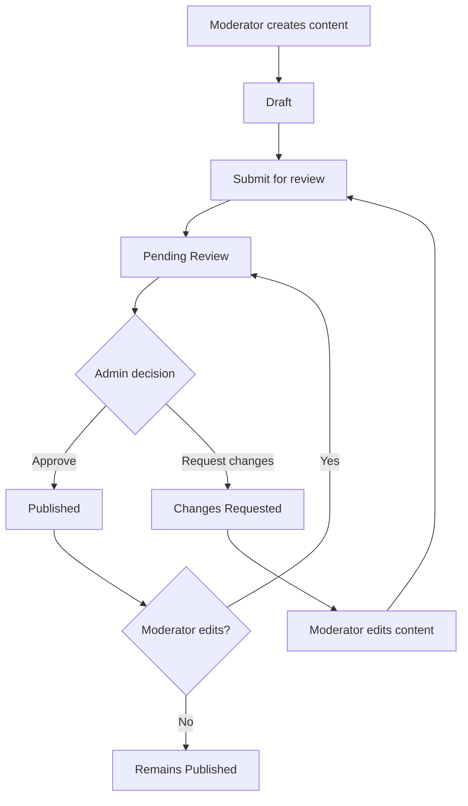

# 09 — Documentation Consistency Review & Approved Revisions

**Project:** Gaming Brand & Community Website  
**Document Version:** 1.0  
**Status:** Review Completed — Approved Changes Recorded  
**Review Date:** 11 November 2026

---

## 1. Review Objective

Review the eight project documents for consistency and record approved changes before implementation.

The review covers:

- Product requirements.
- Public and management workflows.
- UI/UX requirements.
- Technical architecture.
- Database structure.
- Implementation sequence.
- Testing coverage.
- Project decisions and restrictions.

## 2. Newly Approved Decisions

### DEC-031 — Community-Only Public Content

**Status:** Approved  
**Decision:** The public content section is exclusively for permitted gaming and community-related content.

Potential content categories include:

- Gameplay highlights.
- Gaming videos and creator updates.
- Gaming tips and guides.
- Tournament and community announcements.
- Community news and updates.
- Scam-awareness and gaming safety information.

These are initial category examples. The final category list can be adjusted according to the creator's actual content.

**Restrictions:**

The website must not provide:
- Free Fire account sale or purchase listings.
- Account-transfer listings or facilitation.
- Account-transfer prices.
- Purchase buttons for gaming accounts.
- Payment or escrow functionality for account transfers.
- WhatsApp actions intended to facilitate account transactions.

The content system must be designed around legitimate community publishing rather than account trading.

### DEC-032 — Mandatory Admin Approval

**Status:** Approved  
**Decision:** Every content submission made by a Moderator must receive Admin approval before public publication.

Rules:

1. Moderators can create content.
2. New Moderator content starts as Draft.
3. A Moderator submits content for review.
4. Submitted content becomes Pending Review.
5. Admin reviews the submission.
6. Admin can approve and publish it or request changes.
7. Content requiring changes cannot become publicly visible until approved.
8. Admin can create and publish content directly.

**Additional rule:** Editing published Moderator content returns it to Pending Review. The edited content must be approved again before it is publicly visible.

---

## 3. Consistency Review Results

| Area | Review Result | Required Action |
|---|---|---|
| Product scope | Consistent after new decision | Remove marketplace-oriented assumptions |
| Public content | Requires clearer definition | Community-only content |
| Publishing workflow | Incomplete previously | Add Admin approval |
| Moderator permissions | Mostly consistent | Enforce publishing restrictions |
| Admin permissions | Consistent | Add review queue and approval actions |
| Public pages | Consistent | Show only approved community content |
| UI/UX | Requires workflow updates | Add review states and moderation feedback |
| Technical architecture | Requires authorization updates | Enforce approval on backend |
| Database schema | Requires lifecycle update | Add Changes Requested state |
| Implementation plan | Requires sequence updates | Implement moderation before public publishing |
| Testing plan | Requires new tests | Test approval, rejection/change requests, and republishing |
| Decision log | Requires new entries | Record DEC-031 and DEC-032 |

---

## 4. Approved Revisions by Document

### 4.1 PRD — Version 1.2

**Previous:** PRD v1.1

**Required changes:**

1. Replace ambiguous public content descriptions with community-only content.
2. Make Admin approval mandatory for Moderator submissions.
3. Define Admin's review responsibilities.
4. Add a content review queue to Admin requirements.
5. Add change-request feedback for Moderators.
6. Ensure public content pages display only approved and published content.
7. Clarify that editing published Moderator content requires reapproval.
8. Keep account sale, transfer, and transaction functionality excluded.

**New acceptance criteria:**

- A Moderator cannot publish content directly.
- A Moderator submission cannot appear publicly before Admin approval.
- Admin can approve and publish a submission.
- Admin can request changes.
- A Moderator can revise content and resubmit it.
- An edit to published Moderator content cannot bypass review.
- Unapproved content cannot be accessed through public URLs.

### 4.2 App Flow — Version 1.1

**Previous:** App Flow v1.0

**Updated Moderator workflow:**

1. Moderator logs in.
2. Moderator opens content management.
3. Moderator creates or edits permitted content.
4. Moderator saves it as Draft or submits it for review.
5. Submitted content appears in the Pending Review state.
6. Moderator can see the review status.
7. If changes are requested, Moderator reads the Admin feedback.
8. Moderator updates the content and resubmits it.
9. After approval, content becomes public.

**Updated Admin workflow:**

1. Admin logs in.
2. Admin opens the content review queue.
3. Admin selects a pending submission.
4. Admin reviews the content.
5. Admin approves and publishes, or requests changes.
6. The system records the action in activity logs.
7. Moderator can see the review result.

**Updated public workflow:**

Visitors see only published, approved, permitted community content.

### 4.3 UI/UX Specification — Version 2.1

**Previous:** UI/UX Specification v2.0

The Brand-led Gaming Editorial design remains the approved provisional visual baseline.

Required interface updates:

**Public website:**
- Community-oriented content labels and categories.
- No account-buying or account-selling interface.
- No transaction-oriented calls to action.
- Clear scam-awareness messaging.

**Moderator dashboard:**
- Draft.
- Pending Review.
- Changes Requested.
- Published.
- Unpublished.
- Archived.

**Admin dashboard:**
- Pending Review queue.
- Content preview.
- Approve and Publish action.
- Request Changes action.
- Feedback field.
- Review history.

**Moderator feedback:**

When Admin requests changes, the Moderator should see the feedback associated with the content submission.

The design must maintain the existing editorial visual direction. These workflow additions should not introduce a generic SaaS dashboard aesthetic.

### 4.4 TRD — Version 1.1

**Previous:** TRD v1.0

Required technical updates:

- Implement server-side content review authorization.
- Only Admin can approve and publish Moderator submissions.
- Only Admin can request changes.
- Moderators can edit only their own permitted content.
- Moderators cannot change a content record directly to Published.
- Public queries must filter by the approved publication state.
- Editing published Moderator content must trigger the review workflow.
- All review actions must be logged.

**Backend enforcement:**

The backend must reject unauthorized status changes even if a user sends a manually constructed HTTP request.

Frontend buttons and dropdown restrictions are not sufficient.

### 4.5 Database Schema — Version 1.1

**Previous:** Database Schema v1.0

Update the `contents` lifecycle status definition.

Recommended status values:

| Status | Meaning |
|---|---|
| draft | Created but not submitted |
| pending_review | Submitted and waiting for Admin |
| changes_requested | Admin requires modifications |
| published | Approved and publicly visible |
| unpublished | Previously published but no longer public |
| archived | Retained for historical purposes |

Soft deletion remains a separate database concern rather than a normal publication status.

**Additional review fields:**

The existing content table should support:

- `reviewed_by` — nullable reference to the Admin user who reviewed the content.
- `reviewed_at` — nullable review timestamp.
- `review_feedback` — nullable feedback from Admin.

The existing `published_at` field should represent the latest successful publication time.

**Important relationship rules:**

- `created_by` identifies the content owner.
- `reviewed_by` identifies the reviewing Admin.
- A Moderator cannot assign themselves as reviewer.
- Review actions must be recorded in `activity_logs`.

**Review behavior:**

- New Moderator submission: `draft` → `pending_review`.
- Admin approval: `pending_review` → `published`.
- Admin requests changes: `pending_review` → `changes_requested`.
- Moderator resubmission: `changes_requested` → `pending_review`.
- Published Moderator content edited: `published` → `pending_review`.
- Admin may unpublish or archive content according to permissions.

The migration must enforce these rules through application logic and authorization policies. Database enum or check-constraint choices should remain compatible with the selected Laravel and MySQL versions.

**Review feedback history:**

The single `review_feedback` field is sufficient for the initial MVP if only the latest review feedback needs to be displayed.

If a complete history of multiple review conversations is required later, introduce a separate `content_reviews` table. Do not add that complexity without a demonstrated requirement.

### 4.6 Implementation Plan — Version 1.1

**Previous:** Implementation Plan v1.0

Update the implementation sequence:

1. Documentation approval.
2. Laravel project setup.
3. Database migrations and seeders.
4. Authentication and role authorization.
5. Moderator profiles and presence.
6. Content creation and ownership.
7. Admin content review workflow.
8. Public content listing and details.
9. Announcements and activity logs.
10. Dashboard and UI refinement.
11. Testing and security review.
12. Staging and production deployment.

**Important sequencing change:**

Public content publication must not be implemented as a completed feature before the Admin approval workflow is available.

The review workflow should be implemented and tested before enabling public publication.

### 4.7 Testing Plan — Version 1.1

**Previous:** Testing Plan v1.0

Add these mandatory tests:

| ID | Test | Expected Result |
|---|---|---|
| REV-01 | Moderator creates content | Content is Draft |
| REV-02 | Moderator submits content | Content becomes Pending Review |
| REV-03 | Pending content is opened publicly | Access denied or not found |
| REV-04 | Moderator attempts direct publishing | Request rejected |
| REV-05 | Admin approves content | Content becomes Published |
| REV-06 | Admin requests changes | Content becomes Changes Requested |
| REV-07 | Moderator updates requested content | Content can be resubmitted |
| REV-08 | Moderator edits published content | Content returns to Pending Review |
| REV-09 | Edited content is accessed publicly | Updated version is not publicly visible |
| REV-10 | Admin approves revised content | Revised content becomes public |
| REV-11 | Moderator attempts to approve content | Request rejected |
| REV-12 | Review action occurs | Activity log is created |
| REV-13 | Public content listing is queried | Only approved published content appears |

### 4.8 Decision Log — Version 1.1

Add the approved decisions:

- DEC-031 — Community-Only Public Content.
- DEC-032 — Mandatory Admin Approval.

Keep previous approved decisions and pending technical decisions intact.

---

## 5. Updated Content Lifecycle

The following represents the approved MVP publishing workflow.

Admin may also unpublish or archive content when required.

Public visibility is allowed only when the content is approved, published, and otherwise eligible for public display.

---

## 6. Updated Role Permission Matrix

| Action | Visitor | Moderator | Admin |
|---|---:|---:|---:|
| View published content | Yes | Yes | Yes |
| View public Moderator profiles | Yes | Yes | Yes |
| Create content | No | Yes | Yes |
| Edit own content | No | Yes | Yes |
| Edit another Moderator's content | No | No | Yes |
| Submit content for review | No | Yes | Optional |
| Approve content | No | No | Yes |
| Request content changes | No | No | Yes |
| Publish Moderator submission | No | No | Yes |
| Manage Moderators | No | No | Yes |
| Manage announcements | No | No | Yes |
| View platform activity logs | No | No | Yes |

---

## 7. Updated Approval Summary

| Document | Target Version | Current Status |
|---|---:|---|
| PRD | 1.2 | Approved changes recorded; revision pending |
| App Flow | 1.1 | Approved changes recorded; revision pending |
| UI/UX Specification | 2.1 | Approved changes recorded; revision pending |
| TRD | 1.1 | Approved changes recorded; revision pending |
| Database Schema | 1.1 | Approved changes recorded; revision pending |
| Implementation Plan | 1.1 | Approved changes recorded; revision pending |
| Testing Plan | 1.1 | Approved changes recorded; revision pending |
| Decision Log | 1.1 | Approved changes recorded; revision pending |

The two new product decisions are approved. This does not automatically approve the full revised documents or unresolved technical details.

---

## 8. Remaining Technical Decisions

These items should be resolved before the affected implementation work begins:

1. Final MySQL version based on hosting support.
2. Contact information storage approach.
3. Activity log retention period.
4. Session and password-reset configuration.
5. Final hosting and deployment environment.
6. Backup frequency and recovery requirements.
7. Final public community content categories.
8. Final creator branding assets.

Use reasonable Laravel conventions for implementation details that do not materially affect product behavior. Record any significant technical choice in the Decision Log.

---

## 9. Review Conclusion

The documentation is now aligned around two important product rules:

1. The website is a gaming community platform, not an account marketplace.
2. Admin approval is mandatory before Moderator-submitted content becomes public.

The architecture, database, UI, implementation plan, and testing strategy must all enforce these rules.

**Next milestone:** Complete the full document revisions, review the remaining technical decisions, approve the database schema and implementation plan, and begin Laravel project setup.

**Document Status:** Review Completed — Approved Changes Recorded.